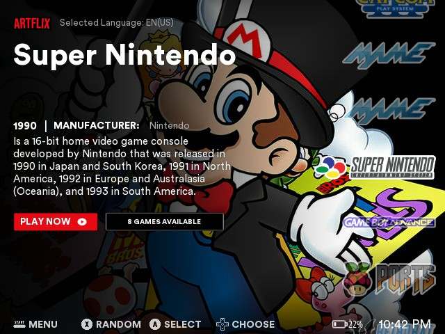
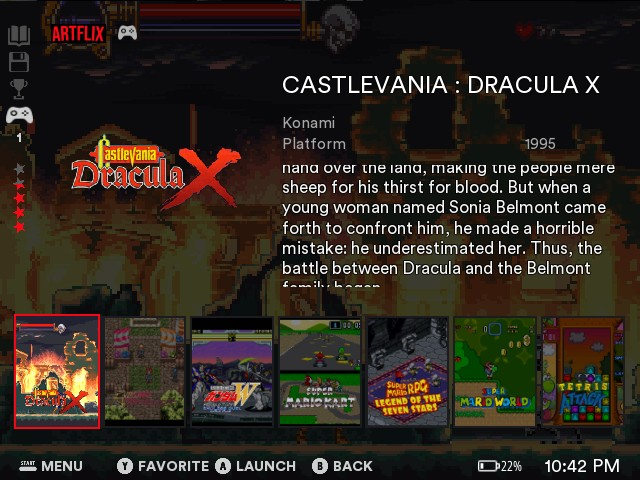
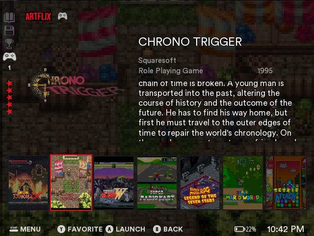
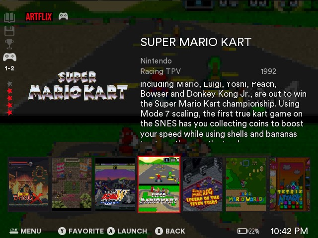

# es-theme-artflix-fcamod

**EN** · [BR](README.pt-BR.md)

  

Fork of **Alekfull ARTFLIX** (by fagnerpc, made for Batocera / RetroBat) for **EmulationStation-fcamod** on the **R36S** and clones (ArkOS family, 640×480): the Netflix-like home with the system's art as the background, big name, description, **PLAY NOW** button and the vertical carousel of logos, and a game list in the same style.

    
   

[Install](#install) · [The theme](#the-theme) · [Options](#options) · [Compatibility](#compatibility) · [Customize](#customize) · [Credits](#credits-and-license)

## Install

1. Download this repository (**Code → Download ZIP**) or clone it.
2. Copy the folder to the themes folder of your device: `/roms/themes/` (the `themes` folder of the games partition) or `~/.emulationstation/themes/`. It must be named `es-theme-artflix-fcamod` (or `es-theme-artflix-fcamod-main` from the ZIP). When updating, delete the old folder first.
3. **START → UI Settings → Theme Set → es-theme-artflix-fcamod**. The options are in **UI Settings → Theme Configuration**.

Leave the frontend's **Gamelist View Style** and **Grid Size** on **automatic**: other values replace the theme's game list layout.

## The theme

- **System view (the base's "Default Artflix"):** the art of the system as the background with the dark gradient, the ARTFLIX logo, the name in big letters, year and manufacturer / developer, the description, the red **PLAY NOW** button and the outlined button with the number of games, a random game video of the system at the bottom left, and the **vertical carousel of logos** at the right (the selected one is the big one).
- **Game list:** the game's image is the background, the game's wheel at the left, name, developer, genre, year, rating and description at the right, and a row of **covers** (3:4: the game's image with its wheel over it) at the bottom, the selected one with a red frame. The column of icons at the left edge of the base: manual, save state and achievements (dim: ES-fcamod has no data for them), the gamepad with the number of players and the rating stars.
- **Button legend** at the bottom, with the base's own icons; clock and battery on the same line.
- The base's **menu** (red titles, grey text, red selector).
- **26 languages** for every label and button; the description of each system is in the languages the base has (English, Portuguese, Spanish, French, German and Chinese), English in the others.
- Art, logos and texts for the platforms of the ArkOS family that the base covers; the rest show the plain dark art and their name as text.

## Options

| Option | Choices (default first) | Notes |
|---|---|---|
| Aspect Ratio | 4:3 | 640×480 screens (R36S, RG351MP...). |
| Random Video | Yes / No | The random game video of the system at the bottom left of the system view (needs scraped videos). |

## Compatibility

What has actually been tested, and how:

| | Theme |
|---|---|
| dArkOS4Clone | ✅ |
| ArkOS, arkos4clone, dArkOS, dArkOSRE-R36, dArkOSen | 🧪 |
| Batocera, Knulli, EmuELEC, ArchR, muOS | not tested |

- ✅ **Validated on real hardware** (R36S): system view, game list, clock, battery, button legend, menu, covers and frames.
- 🧪 **Waiting for feedback:** same frontend family and same theme elements as the other themes of the series, which are checked against each system's EmulationStation.

Known limits of fcamod that a theme cannot change: unselected logos of the carousel are drawn at 50 % opacity, there are no animations, no shaders and no manual / save state / achievements data (their icons in the game list are dim and fixed), a game name longer than two lines is cut, and a game's video does not play over its image in the list (the random video of the system view does).

**Help test your system:** tell me your system, its version and what looks wrong, by [opening an issue](https://github.com/jovemlcxx/es-theme-artflix-fcamod/issues) or [on Reddit](https://www.reddit.com/user/jovemlcxx/) (u/jovemlcxx).

## Customize

Files are named after the system's `<theme>` entry in `es_systems.cfg` (e.g. `snes`, `megadrive`), not the ROM folder. All paths are inside `_inc/`.

| What | Where | Size |
|---|---|---|
| Background art of a system | `arts/<theme>.jpg` | 640×480 |
| Logo of a system (carousel) | `logos/<theme>.png` | up to 332×166, transparent |
| Name, year, manufacturer and description | `info/<theme>.xml` | text |
| Translations | `lang/<code>.xml` | |
| Layout | `aspect-ratio-4-3.xml` | written as fractions of 640×480 |

## Credits and license

**This theme is a fork of [Alekfull ARTFLIX](https://github.com/fagnerpc/Alekfull-ARTFLIX) by fagnerpc** (https://facebook.com/alekfull.arcade): the art, logos, texts, icons, fonts, sounds, buttons, colours and the whole look are his; this repository only adapts them to EmulationStation-fcamod at 640×480. The base is **not authorized for commercial use**, and neither is this fork. Not affiliated with Netflix. The fonts (Circular Std, Open Sans) are the base's.

Selling it, alone or bundled with devices, SD cards or images, is not allowed. See [LICENSE](LICENSE).

**Support:** if this theme is useful to you, you can support my work on [Ko-fi](https://ko-fi.com/jovemlcxx). Thank you! ☕

