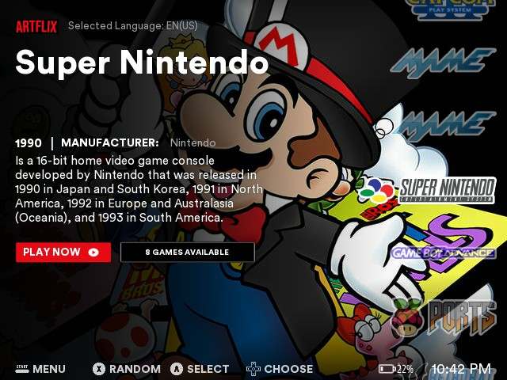
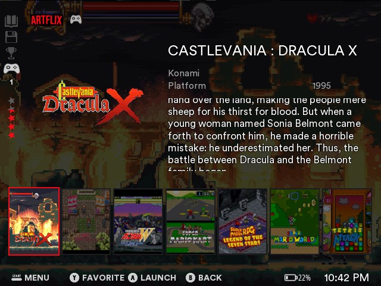
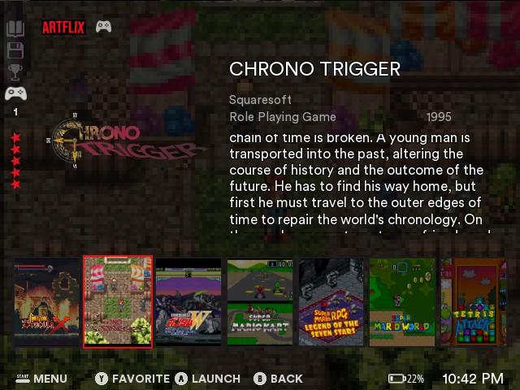
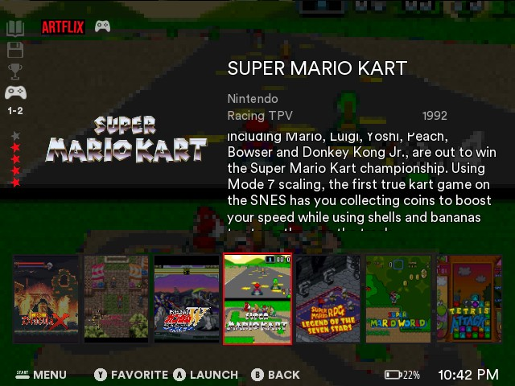

# es-theme-artflix-fcamod

[EN](README.md) · **BR**

  

Fork do **Alekfull ARTFLIX** (de fagnerpc, feito para Batocera / RetroBat) para o **EmulationStation-fcamod** no **R36S** e clones (família ArkOS, 640×480): a tela inicial no estilo Netflix com a arte do sistema de fundo, nome grande, descrição, botão **JOGAR AGORA** e o carrossel vertical de logos, e uma lista de jogos no mesmo estilo.

    
   

[Instalação](#instalação) · [O tema](#o-tema) · [Opções](#opções) · [Compatibilidade](#compatibilidade) · [Personalizar](#personalizar) · [Créditos e licença](#créditos-e-licença)

## Instalação

1. Baixe este repositório (**Code → Download ZIP**) ou clone-o.
2. Copie a pasta para a pasta de temas do aparelho: `/roms/themes/` (a pasta `themes` da partição de jogos) ou `~/.emulationstation/themes/`. Ela deve se chamar `es-theme-artflix-fcamod` (ou `es-theme-artflix-fcamod-main`, vinda do ZIP). Ao atualizar, apague a pasta antiga antes.
3. **START → CONFIGURAR INTERFACE → TEMA → es-theme-artflix-fcamod**. As opções ficam em **CONFIGURAR INTERFACE → CONFIGURAÇÕES DE TEMA**.

Deixe o **MODO DE VISUALIZAÇÃO, LISTA DE JOGO** e o **TAMANHO DA GRADE** do frontend em **automático**: outros valores substituem o layout da lista de jogos do tema.

## O tema

- **Tela de sistemas (o "Default Artflix" do original):** a arte do sistema de fundo com o degradê escuro, o logo ARTFLIX, o nome em letras grandes, ano e fabricante / desenvolvedor, a descrição, o botão vermelho **JOGAR AGORA** e o botão com contorno com o número de jogos, e o **carrossel vertical de logos** à direita (o selecionado é o grande).
- **Lista de jogos:** a imagem do jogo é o fundo (e o **vídeo** do jogo, quando ele tem, preenche o fundo alguns segundos depois de você selecionar o jogo), o wheel do jogo à esquerda, nome, desenvolvedor, gênero, ano, nota e descrição à direita, e uma fileira de **capas** (3:4: a imagem do jogo com o wheel por cima) embaixo, a selecionada com moldura vermelha. A coluna de ícones na borda esquerda do original: manual, save state e conquistas (apagados: o ES-fcamod não tem esses dados), o controle com o número de jogadores e as estrelas da nota.
- **Legenda dos botões** embaixo, com os ícones do original; relógio e bateria na mesma linha.
- O **menu** do original (títulos vermelhos, texto cinza, seletor vermelho).
- **26 idiomas** em todos os rótulos e botões; a descrição de cada sistema vem nos idiomas que o original tem (inglês, português, espanhol, francês, alemão e chinês), em inglês nos outros.
- Arte, logos e textos das plataformas da família ArkOS que o original cobre; as outras mostram a arte escura lisa e o nome em texto.

## Opções

| Opção | Escolhas (padrão primeiro) | Observações |
|---|---|---|
| Proporção de Tela | 4:3 | Telas 640×480 (R36S, RG351MP...). |

## Compatibilidade

O que foi realmente testado, e como:

| | Tema |
|---|---|
| dArkOS4Clone | ✅ |
| ArkOS, arkos4clone, dArkOS, dArkOSRE-R36, dArkOSen | 🧪 |
| Batocera, Knulli, EmuELEC, ArchR, muOS | não testado |

- ✅ **Validado no aparelho** (R36S): tela de sistemas, lista de jogos, relógio, bateria, legenda dos botões, menu, capas e molduras.
- 🧪 **Aguardando retorno:** mesma família de frontend e mesmos elementos de tema dos outros temas da série, que são conferidos contra o EmulationStation de cada sistema.

Limites do fcamod que um tema não consegue mudar: os logos não selecionados do carrossel são desenhados com 50 % de opacidade, não há animações nem shaders, não existem dados de manual / save state / conquistas (os ícones deles na lista de jogos ficam apagados e fixos), nome de jogo com mais de duas linhas é cortado e o vídeo de um jogo só toca depois de o jogo ficar alguns segundos selecionado.

**Ajude a testar o seu sistema:** me conte qual é o sistema, a versão e o que parece errado, [abrindo uma issue](https://github.com/jovemlcxx/es-theme-artflix-fcamod/issues) ou [pelo Reddit](https://www.reddit.com/user/jovemlcxx/) (u/jovemlcxx).

## Personalizar

Os arquivos levam o nome de tema do sistema (a tag `<theme>` do `es_systems.cfg`, por exemplo `snes`, `megadrive`), não o da pasta de ROMs. Todos os caminhos ficam dentro de `_inc/`.

| O quê | Onde | Tamanho |
|---|---|---|
| Arte de fundo de um sistema | `arts/<tema>.jpg` | 640×480 |
| Logo de um sistema (carrossel) | `logos/<tema>.png` | até 332×166, transparente |
| Nome, ano, fabricante e descrição | `info/<tema>.xml` | texto |
| Traduções | `lang/<código>.xml` | |
| Layout | `aspect-ratio-4-3.xml` | escrito em frações de 640×480 |

## Créditos e licença

**Este tema é um fork do [Alekfull ARTFLIX](https://github.com/fagnerpc/Alekfull-ARTFLIX), de fagnerpc** (https://facebook.com/alekfull.arcade): a arte, os logos, os textos, os ícones, as fontes, os sons, os botões, as cores e todo o visual são dele; este repositório só os adapta ao EmulationStation-fcamod em 640×480. O original **não é autorizado para uso comercial**, e este fork também não é. Sem afiliação com a Netflix. As fontes (Circular Std, Open Sans) são as do original.

**Licença:** [CC BY-NC-SA 4.0](LICENSE), a mesma dos meus outros temas. Gratuito: é proibido vendê-lo, sozinho ou junto com aparelhos, cartões SD ou imagens.

**Apoio:** se este tema for útil para você, pode apoiar meu trabalho no [Ko-fi](https://ko-fi.com/jovemlcxx). Obrigado! ☕

